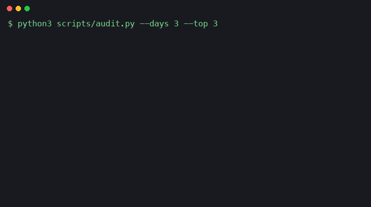

# agent-skills

Free Claude Code skills for agent work: check a release before you ship it, check the files of an agent team, and see where your tokens go. Each skill has a free edition here and a full edition on Polar. Everything runs locally, with no network access.

Skills in this repo work with any agent that reads SKILL.md. The install line below is for Claude Code.

| Skill | What it does | Edition |
|---|---|---|
| [release-gate-lite](release-gate-lite/) | One PASS, HOLD or FAIL verdict before a release: secrets, version, changelog, merge markers, clean tree. | Free, MIT |
| release-gate | One PASS, HOLD or FAIL verdict before a release. Checks secrets, versions, changelog, debug leftovers, large files, README links, tests and remote status, then your agent reviews the diff and drafts release notes. | [$7 one-time](https://buy.polar.sh/polar_cl_zGKv60a7zfftMDwtEse3Gq4Bsx5Gd5wDiXnm01q51F4) |
| [agent-team-check-lite](agent-team-check-lite/) | Checks the team files of a group of agent sessions for idle roles, broken reporting lines and template text left in tasks. | Free, MIT |
| agent-team-ops | Runs several AI agent sessions as one team: creates ORG.md and TEAM_PLAN.md, then checks for idle roles, broken reporting lines and tasks with no purpose. Includes 11 operating rules. | [$12 one-time](https://buy.polar.sh/polar_cl_0RUUUFGvqGayeWXaK1PxhAuQSrHMRDJHEkuoZ0xJOV3) |
| [agent-token-auditor-lite](agent-token-auditor-lite/) | Reads your local Claude Code logs and shows where your tokens went, with the costly patterns and a fix for each. | Free, MIT |
| agent-token-auditor (full) | Adds the fix playbook, ready CLAUDE.md rules and a guided workflow that applies the fixes. | [$9 one-time](https://buy.polar.sh/polar_cl_a3PsNiRzvZ4szsrbQS1eHOvKSEymZvFHIGegX0Q2rJT) |
| [lessons-log-lite](lessons-log-lite/) | Checks a LESSONS.md file of standing rules: rules with no evidence, review dates that passed, rules with the same title, a file that grew too big. | Free, MIT |
| lessons-log | Turns an incident into one short standing rule with evidence and a review date. Adds rules, renews and archives overdue ones, converts a file of plain bullets, with a fix guide and a before-and-after check. | [$7 one-time](https://buy.polar.sh/polar_cl_Kh5u3AuxemqQUYOrHAhyxVtoHx8xcgWQvDvzU1SuEPo) |
| [numbers-check-lite](numbers-check-lite/) | Checks that every number in a Markdown report has a label (verified, inferred, unverified or not found), a source and a time. | Free, MIT |
| numbers-check | Labels, sources and times for every number in a report, then re-checks the numbers that change with a command you list (MATCH or DIFFERENT). Fix guide and before-and-after check. | [$9 one-time](https://buy.polar.sh/polar_cl_Ls5Jzr8nGz1CyxFFYtIKXRYPlFC9ZGks6mqeL1s1ujI) |
| [research-brief-lite](research-brief-lite/) | Checks a research brief: a question, a search budget, a stop rule, a label on every claim, a source and a date on every verified claim. | Free, MIT |
| research-brief | Sets the question, the search budget and the stop rule before the first search, logs each search and read, and refuses the next one when the budget is spent. Fix guide and before-and-after check. | [$9 one-time](https://buy.polar.sh/polar_cl_c3IMazGk7ocx6JpKwmUcGP8WPms58i1pAnAbz2QTI43) |

All three full editions together, [All 3 packs for $19](https://buy.polar.sh/polar_cl_0NhKpsS3Zs6kOUrxkurweJd57GdowIOfceWDR2Rq94C) (bought separately: $28). The three are agent-token-auditor, release-gate and agent-team-ops.

Launch code `LAUNCH30` takes 30% off any single pack at checkout: release-gate, agent-team-ops, agent-token-auditor, lessons-log, numbers-check and research-brief. It ends 8 Nov 2026 23:59 UTC and works for the first 50 uses. LAUNCH30 applies to single packs; the bundle is already discounted.

## Install

```bash
npx skills add MalikKhaledSaid/agent-skills
```

As a Claude Code plugin, from inside Claude Code:

```text
/plugin install release-gate-lite --marketplace MalikKhaledSaid/agent-skills
/plugin install agent-team-check-lite --marketplace MalikKhaledSaid/agent-skills
/plugin install agent-token-auditor-lite --marketplace MalikKhaledSaid/agent-skills
/plugin install lessons-log-lite --marketplace MalikKhaledSaid/agent-skills
/plugin install numbers-check-lite --marketplace MalikKhaledSaid/agent-skills
/plugin install research-brief-lite --marketplace MalikKhaledSaid/agent-skills
```

Or copy a skill folder into `~/.claude/skills/`.

## agent-token-auditor: from a usage report to a fix

Tools such as ccusage report how many tokens you used. agent-token-auditor-lite goes one step further: it reads your own local session logs, ranks your sessions by cost, and names the habits behind the spend, with a one-line fix for each. The full edition adds a fix playbook for each pattern, ready CLAUDE.md rules and a guided workflow where your agent applies the fixes.



Real run on the author's own multi-agent workload, 26 Oct 2026, last 3 days. Session names replaced. Weighted tokens: 301.6M over 57 sessions. 64% came from turns above 150k context. 27% ran inside subagents. 41 tool results were longer than 20,000 characters.

### agent-token-auditor: free and full edition

| | Free: agent-token-auditor-lite | Full: agent-token-auditor, $9 |
|---|---|---|
| Token report by session, day and model | Yes | Yes |
| Costly patterns, each with a one-line fix | Yes | Yes |
| Fix playbook for each finding | No | Yes |
| Ready-to-paste CLAUDE.md rules | No | Yes |
| Guided workflow where your agent applies the fixes | No | Yes |

[Get the full edition ($9, one-time)](https://buy.polar.sh/polar_cl_a3PsNiRzvZ4szsrbQS1eHOvKSEymZvFHIGegX0Q2rJT)

## Principles
- Each skill runs locally and states exactly what it reads.
- No telemetry and no network calls, unless a skill says otherwise.
- Scripts use the Python standard library only.
